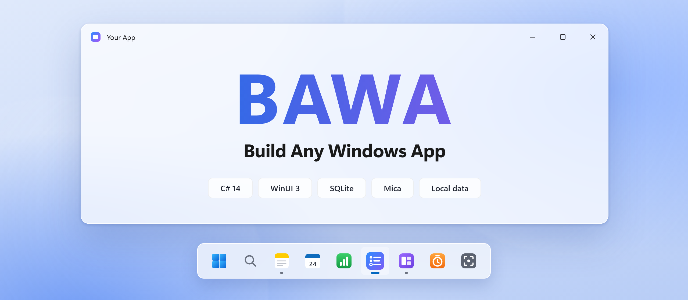
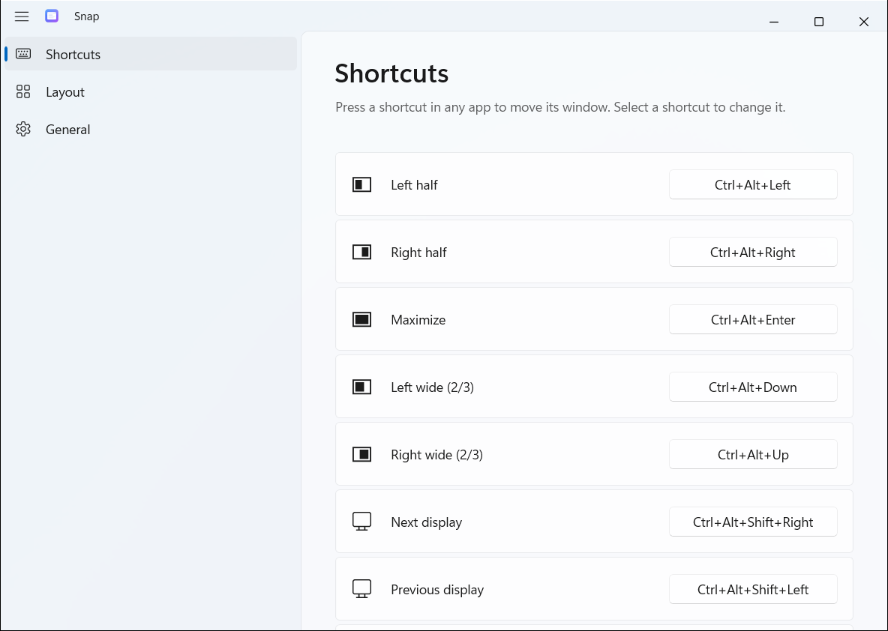

<div align="center">

<picture>
  <source media="(prefers-color-scheme: dark)" srcset="docs/assets/banner-dark.png">
  <source media="(prefers-color-scheme: light)" srcset="docs/assets/banner-light.png">
  
</picture>

### See an app you like. Rebuild it as your own native Windows app.

Agent skills that take a native Windows app from idea to your taskbar.<br>
C# and WinUI 3. Local data. No Visual Studio.

[](#requirements)
[](#requirements)
[](#requirements)
[](#skills)
[](#install)
[](#install)
[](LICENSE)

**[Quick start](#quick-start) · [How it works](#how-it-works) · [Skills](#skills) · [Specs](#specs) · [Install](#install)**

</div>

## Quick start

```bash
npx skills@latest add daveebbelaar/bawa
```

Then ask your agent:

```text
Clone my to-do app as a native Windows app.
Screenshot every screen, write the user stories, and build milestone 1.
```

Not sure where to start? Type `/bawa`. It looks at your project and picks the next skill.

On a Mac? BAWA's sibling is [BAMA: Build Any Mac App](https://github.com/daveebbelaar/bama). Same pipeline, same skill names, Swift and SwiftUI.

## How it works

<table>
<tr>
<td width="33%" valign="top">

**1. Clone**

Your agent opens the app you like and screenshots every screen. It writes a screen index.

</td>
<td width="33%" valign="top">

**2. Plan**

It turns the screens into user stories with checkable acceptance criteria, in milestones.

</td>
<td width="33%" valign="top">

**3. Build**

It builds one story per commit. Before each commit it runs the self-test, snapshots every page in light and dark mode, and checks the grid.

</td>
</tr>
</table>

Every app BAWA makes can check itself. It has a self-test that runs its real functions, a snapshot mode that captures every page in light and dark, and a layout probe that fails on misaligned edges. The agent sees what you would see before it calls a change done.

## Skills

<table>
<tr><th>Stage</th><th>Skill</th><th>What it does</th></tr>
<tr><td rowspan="3" valign="top"><b>Start</b></td><td nowrap><a href="skills/start/bawa/SKILL.md"><samp>bawa</samp></a></td><td>Router: finds where you are and calls the right skill</td></tr>
<tr><td nowrap><a href="skills/start/app-brief/SKILL.md"><samp>app-brief</samp></a></td><td>Turns an idea into a one-page brief</td></tr>
<tr><td nowrap><a href="skills/start/new-windows-app/SKILL.md"><samp>new-windows-app</samp></a></td><td>A working app from a template: WinUI 3, SQLite, build and install script, snapshot mode, self-test, git</td></tr>
<tr><td rowspan="3" valign="top"><b>Plan</b></td><td nowrap><a href="skills/plan/research/SKILL.md"><samp>research</samp></a></td><td>Parallel researcher agents: market, users, features, design, Windows APIs</td></tr>
<tr><td nowrap><a href="skills/plan/clone/SKILL.md"><samp>clone</samp></a></td><td>Screenshots every screen of any app with computer use or a browser, writes a screen index</td></tr>
<tr><td nowrap><a href="skills/plan/user-stories/SKILL.md"><samp>user-stories</samp></a></td><td>A backlog with checkable acceptance criteria, in milestones</td></tr>
<tr><td rowspan="5" valign="top"><b>Code</b></td><td nowrap><a href="skills/code/csharp-winui/SKILL.md"><samp>csharp-winui</samp></a></td><td>C# 14 and WinUI 3: threads, x:Bind, observable models, SQLite, Win32 interop, build and launch errors</td></tr>
<tr><td nowrap><a href="skills/code/os-integrations/SKILL.md"><samp>os-integrations</samp></a></td><td>Global hotkeys, tray icon, floating panels, window control, clipboard, screen capture, toasts, startup, URL protocols</td></tr>
<tr><td nowrap><a href="skills/code/performance/SKILL.md"><samp>performance</samp></a></td><td>Measure, then fix: startup, UI thread hangs, virtualization, images, GPU, traces from the command line</td></tr>
<tr><td nowrap><a href="skills/code/improve-architecture/SKILL.md"><samp>improve-architecture</samp></a></td><td>Finds hot spots as the app grows and refactors one step per commit, with behavior proven unchanged</td></tr>
<tr><td nowrap><a href="skills/code/agent-cli/SKILL.md"><samp>agent-cli</samp></a></td><td>Optional: a command line and MCP server, so Claude Code, Codex, and scripts can drive your app</td></tr>
<tr><td rowspan="7" valign="top"><b>Design</b></td><td nowrap><a href="skills/design/ux-design/SKILL.md"><samp>ux-design</samp></a></td><td>Names, flow, where each feature opens (inline, flyout, dialog, window), words, and accessibility, before code</td></tr>
<tr><td nowrap><a href="skills/design/windows-design/SKILL.md"><samp>windows-design</samp></a></td><td>Mica, the title bar, navigation, command bars, menus, keyboard, type, dark mode: Windows 11 the way Microsoft builds it</td></tr>
<tr><td nowrap><a href="skills/design/design-system/SKILL.md"><samp>design-system</samp></a></td><td>Native look with an accent color people pick in Settings, then one set of tokens and one rules page</td></tr>
<tr><td nowrap><a href="skills/design/layout-grid/SKILL.md"><samp>layout-grid</samp></a></td><td>A 4 epx grid with checks that fail on misalignment: a code lint, a layout probe in snapshot mode, and a grid overlay</td></tr>
<tr><td nowrap><a href="skills/design/design-kit/SKILL.md"><samp>design-kit</samp></a></td><td>Your own parts, not Fluent's: three token layers, type, an icon set, every part in every state, custom title bar, and a parts gallery</td></tr>
<tr><td nowrap><a href="skills/design/design-from-app/SKILL.md"><samp>design-from-app</samp></a></td><td>Rebuilds the look of an app you like from its screenshots: measures sizes, type, and colors, then compares pixel by pixel until it matches</td></tr>
<tr><td nowrap><a href="skills/design/app-icon/SKILL.md"><samp>app-icon</samp></a></td><td>An SVG app icon rendered to every Windows size, hand-tuned where small, checked on light and dark</td></tr>
<tr><td rowspan="4" valign="top"><b>Ship</b></td><td nowrap><a href="skills/ship/build-and-verify/SKILL.md"><samp>build-and-verify</samp></a></td><td>Build, install, snapshot every page in light and dark, look at them</td></tr>
<tr><td nowrap><a href="skills/ship/test-windows-app/SKILL.md"><samp>test-windows-app</samp></a></td><td>xUnit, an in-app self-test, UI Automation from outside, a debug bridge an agent can drive</td></tr>
<tr><td nowrap><a href="skills/ship/improve-loop/SKILL.md"><samp>improve-loop</samp></a></td><td>Works through the backlog one story per commit until a milestone is done</td></tr>
<tr><td nowrap><a href="skills/ship/distribute/SKILL.md"><samp>distribute</samp></a></td><td>A build that runs anywhere (self-contained or NativeAOT), signing, a zip or installer, WinGet, the Store</td></tr>
</table>

## Why this stack

C# and WinUI 3 is what Microsoft recommends for new Windows apps in 2026, and the unpackaged, self-contained setup BAWA uses is the one PowerToys requires for its WinUI modules. [docs/STACK.md](docs/STACK.md) compares it with WPF, Avalonia, Uno, MAUI, Tauri, Electron, and the rest, with sources and measured startup times.

Microsoft also ships a WinUI plugin for Claude Code (`winui@win-dev-skills`) and the `winapp` CLI. They focus on setup, packaged MSIX apps, and Developer Mode. BAWA is the whole pipeline (clone, stories, design, the self-test and snapshot loop, distribution) for unpackaged apps. You can install both.

## Specs

Not sure what to build? [specs/](specs/) has 12 build plans for small Windows apps: a window snapper, a window switcher, a launcher, clipboard history, screenshots, a screen recorder, and more. They are the Windows versions of BAMA's specs, which I took apart from Onyx, my own Mac menu bar app. Copy one into an empty folder and tell your agent:

```text
Build the app in window-snapper.md with BAWA.
```

## Built with BAWA

[examples/Snap](examples/Snap) is the window snapper spec, built end to end by an agent with BAWA on a Windows 11 laptop. It snaps the front window to halves, wide sides, and other displays with Ctrl+Alt shortcuts, lives in the tray, and opens at sign-in. Its self-test opens a window of its own, snaps it with every command, and measures where it landed (22 checks), next to 22 unit tests.

<picture>
  <source media="(prefers-color-scheme: dark)" srcset="docs/assets/snap-dark.png">
  
</picture>

## Install

Pick one route per agent. Two routes install every skill twice.

<details open>
<summary><b>Claude Code</b></summary>

```text
/plugin marketplace add daveebbelaar/bawa
/plugin install bawa@bawa
```

</details>

<details>
<summary><b>Codex</b></summary>

```bash
codex plugin marketplace add daveebbelaar/bawa
codex plugin add bawa@bawa
```

</details>

<details>
<summary><b>Any other agent</b> (Cursor, Gemini CLI, Copilot, and more)</summary>

Uses [skills.sh](https://skills.sh). Install all skills, or one with `--skill`.

```bash
npx skills@latest add daveebbelaar/bawa -a <agent>
npx skills@latest add daveebbelaar/bawa --skill=clone
```

</details>

<details>
<summary><b>By hand</b></summary>

```powershell
git clone https://github.com/daveebbelaar/bawa.git
bawa/scripts/link-skills.ps1      # links every skill into ~/.claude/skills and ~/.agents/skills
```

</details>

## Requirements

- Windows 11 (Windows 10 version 2004 or later runs the apps, without Mica)
- The .NET 10 SDK: `winget install Microsoft.DotNet.SDK.10`. Nothing else to build and run: no Visual Studio, no Windows App SDK installer
- To ship: `tools/publish.ps1` makes a build that needs nothing on the other PC. Its faster NativeAOT option also needs the MSVC linker from Visual Studio Build Tools (the `distribute` skill has the one-line install)
- An agent that supports skills: Claude Code, Codex, Cursor, Gemini CLI
- For `clone` on native apps: computer use in the Claude desktop app

## Credits

- The idea and the "any" promise come from
  [REA: Reverse Engineer Anything](https://github.com/morluto/rea) by morluto.
  REA showed that an agent can reverse engineer any app. BAMA took that idea to the Mac; BAWA takes it to Windows.
- Skill format and writing rules follow Matt Pocock's
  [skills](https://github.com/mattpocock/skills) and his
  `writing-for-agents` skill.
- Design rules lean on Microsoft's Windows app design guidance and the
  [WinUI Gallery](https://github.com/microsoft/WinUI-Gallery).

## License

[MIT](LICENSE)
